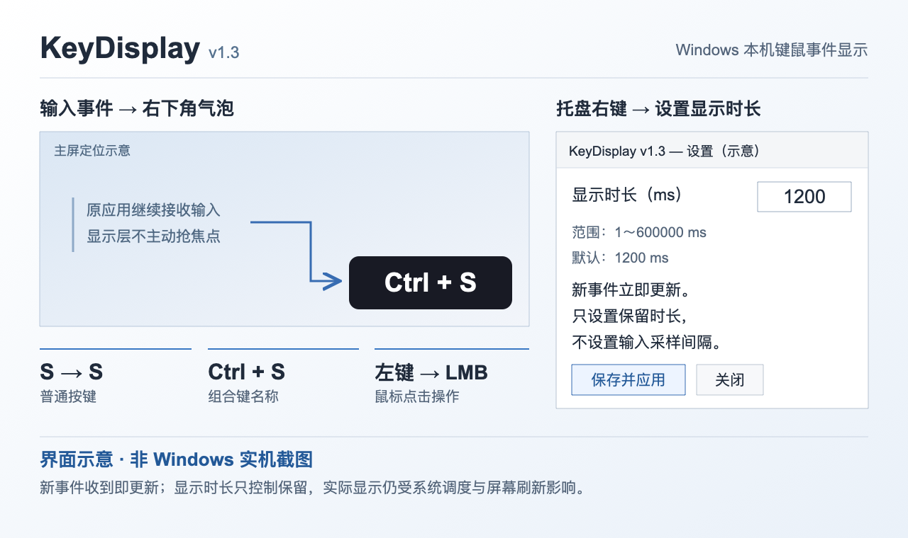

# KeyDisplay v1.3.1

Windows 本机键鼠事件显示工具。使用 Raw Input 旁路接收本机键盘/鼠标事件，把按键名称和点击动作显示在主屏右下角，供录屏、演示及输入响应测试使用。

原生 C++ / Win32 / GDI+，免驱动，不使用浏览器、Electron、ADB 或内核钩子；不录制日志、不联网。

## 下载 Windows EXE

- **[直接下载 KeyDisplay.exe（v1.3.1 / Windows x64）](https://github.com/AFITSAFITS/KeyDisplay/releases/download/v1.3.1/KeyDisplay.exe)**
- **[版本发布页与全部下载附件](https://github.com/AFITSAFITS/KeyDisplay/releases/tag/v1.3.1)**

下载 exe 后双击运行，无需安装。需要核对文件时下载发布页的 `SHA256SUMS.txt`，在 PowerShell 运行 `Get-FileHash .\KeyDisplay.exe -Algorithm SHA256` 并比较。

> 当前 EXE 未签名。已完成交叉编译与逻辑测试，但 v1.3.1 的控制窗口、退出清理、设置及真实显示延时尚未 Windows 实机验收。不要为运行工具关闭系统安全保护；用于延时测试前需标定工具自身显示延迟。

## 功能与设置示意



**这是 v1.3 功能与设置示意，不是 Windows 实机截图；新增的 v1.3.1「设置 / 退出」控制窗口未在此图中展示。** 左侧说明本机输入到右下角气泡，右侧说明毫秒设置。图内按键仅为演示；新输入不会等待当前气泡消失。

## 下载版使用

1. 在 Windows 10/11 x64 上运行 `KeyDisplay.exe`，无需安装。
2. 按 `S`，右下角显示 `S`；按 `Ctrl+S` 显示 `Ctrl + S`；点击鼠标显示 `LMB` / `RMB` / `MMB` / `X1` / `X2`。滚轮显示 `Scroll Up` 等动作。
3. 启动后显示独立控制窗口，**顶部导航栏和大按钮都只有「设置 / 退出」**；任务栏中也有 KeyDisplay 入口。
4. 点击 **设置**，输入显示时长（ms），点 **保存并应用**。关闭设置窗口只关闭设置，不退出程序。
5. 点击控制窗口的 **退出** 或右上角 **×**，完整退出程序；不是隐藏到托盘。最小化可继续采集，点任务栏即可恢复控制窗口。
6. 托盘右键同样提供 **设置 / 退出**，但退出不再依赖托盘图标是否可见。

设置窗口为原生非模态窗口。控制窗口只占一小块普通窗口区域，**不是全屏置顶层**，可最小化；右下角事件叠加层仍点击穿透、不主动抢焦点。

### v1.3.1 退出入口修复

- 控制窗口可见且有任务栏入口，导航菜单与按钮均包含「设置 / 退出」。
- 控制窗口的退出、右上角 ×、托盘退出统一执行同一退出流程：隐藏叠加层 → 停止计时 → 注销键鼠接收 → 删除托盘图标 → 关闭设置/叠加/控制窗口 → 退出消息循环并释放绘图资源。
- 托盘添加失败时，保留普通控制窗口作为设置/退出入口，不再导致无可见控制面板。

## 显示时长设置

- 默认 **1200 ms**；有效范围 **1～600000 ms**，只允许整数。
- “显示时长”指最近一次按下/点击事件的保留时间，不是输入采样周期，也不是批量输出间隔。
- **新事件到达即更新气泡**，不用等上一条气泡消失；每个新按下、重复按下、点击或滚轮事件重新开始计时。
- 松开按键只更新组合键状态，不立刻清掉上一条气泡，避免快速按下/松开来不及被录屏拍到。
- 到期直接隐藏，不用渐变动画作为测试起点。
- 更改时长立即应用到当前气泡；下次启动自动恢复。
- 配置仅写入 `%LOCALAPPDATA%\KeyDisplay\settings.ini`，内容只有 `Display/DurationMs`，不保存输入事件。
- 空值、零、负数、非整数或超范围数值会被拒绝；保存失败不会覆盖原设置。

## 实时显示的实现及测量边界

`WM_INPUT → 更新事件状态 → RenderNow → UpdateLayeredWindow` 在同一次消息处理里执行；不等待以前的 33ms 定时刷新。计时器只负责气泡到期隐藏，不用于收集或推迟新事件。

**“即时提交绘制”不是硬实时或零延时承诺**：仍有 Windows 消息调度、CPU/GDI+ 绘制、DWM 合成、显示器刷新和录屏采样延迟。毫秒设置也不代表屏幕可以达到同等毫秒精度，尤其极短时长可能录不到。

气泡对应本机收到 Raw Input 后的可视反馈，不等价于物理开关闭合的硬件时间戳。用于绝对端到端延时测量前，需要实测/标定叠加层自身的显示延迟；本版未完成该标定。

每次有效事件立即绘制，保留上次验证可用的分层窗口方案：`WS_EX_LAYERED | WS_EX_TRANSPARENT | WS_EX_TOPMOST | WS_EX_NOACTIVATE`，加 `UpdateLayeredWindow` 的预乘 alpha 表面。不使用 `RIDEV_NOLEGACY`、输入阻断、事件重发或注入。位图/DC 缓冲重复利用，鼠标移动不触发绘制；资源占用需在目标机器实际测量。

## 兼容性与限制

- 主屏右下角，距屏幕边缘 24 像素；多屏独立叠加尚未实现。
- 按键名称，不是输入法最终提交文本；`S` 显示为键名 `S`。不读取其他应用的文本内容，但本机输入密码时也可能显示按键名称，敏感输入前请从托盘退出工具。
- 只对所在 Windows 用户桌面会话内可收到的 Raw Input 生效；其他电脑、来宾系统内部、USB 直通给来宾的独立输入、不经本机的输入不在范围内。
- 安全桌面/UAC、独占全屏等特殊场景不能保证显示或采集。
- 启动新版会尝试正常关闭同名旧叠加窗口，不强制终止其他程序；无需开机启动。
- 未签名 exe 可能出现 Windows SmartScreen 提示；本项目不要求关闭系统安全功能。

## 构建

### MinGW-w64（本次构建方式）

Windows：已有 MinGW-w64 后运行 `build-windows.cmd`，或者直接：

```sh
g++ -std=c++17 -Wall -Wextra -Werror -O2 -static -s -mwindows main.cpp -o KeyDisplay.exe -lgdiplus -lgdi32 -luser32 -lshell32 -lole32 -luuid
```

macOS/Linux 交叉编译：已有 MinGW-w64 后运行：

```sh
bash build-mingw.sh
```

Windows 10/11 运行时仅需要系统 DLL；静态链接 MinGW 运行库，不需要另外分发 `libwinpthread-1.dll`。

### CMake / Visual Studio（提供配置，未在本次环境构建验证）

```sh
cmake -S . -B build
cmake --build build --config Release
ctest --test-dir build -C Release --output-on-failure
```

## 自动测试

`display_state.h` 是应用实际使用的跨平台状态逻辑，`test_display_state.cpp` 覆盖输入校验、到期边界、快速按下/松开、组合键释放、重复按下、连续鼠标点击、大时长不延迟新事件、设置即时生效和长运行时间。

本次使用下列命令运行并通过 **29 项断言**：

```sh
clang++ -std=c++17 -Wall -Wextra -Werror test_display_state.cpp -o test-display-state
./test-display-state
```

本版已通过严格交叉编译和 PE/DLL/关键 API 检查；**尚未在 Windows 实机验证 v1.3.1 控制窗口、退出流程、设置、配置持久化、托盘、穿透回归或实际输入到显示延迟**。v1.2 的穿透效果在本对话中得到用户反馈可用，不代表 v1.3.1 已实机验收。

建议复测：把时长设为 300/1200/5000 ms，连续按 S、A、Ctrl+S，确认立刻切换；正常点击桌面及被测窗口；打开/关闭设置；重启应用检查时长保留。退出应立即恢复到无叠加状态。

## 开源

按用户选择使用 **MIT** 许可证，见 `LICENSE`。源码包含完整源码、共享状态头文件、构建脚本、CMake 配置、测试和说明。代码独立实现，未复制 Carnac/Keyviz 源码。

源码按 **MIT** 许可发布到 GitHub 仓库 `AFITSAFITS/KeyDisplay`。仓库仅包含源码、构建脚本、测试和说明，不提交 EXE、本机配置、输入记录或账号信息。贡献与发布规范见 `CONTRIBUTING.md`。若代码权属涉及单位或职务成果，维护者须确认相应授权。
